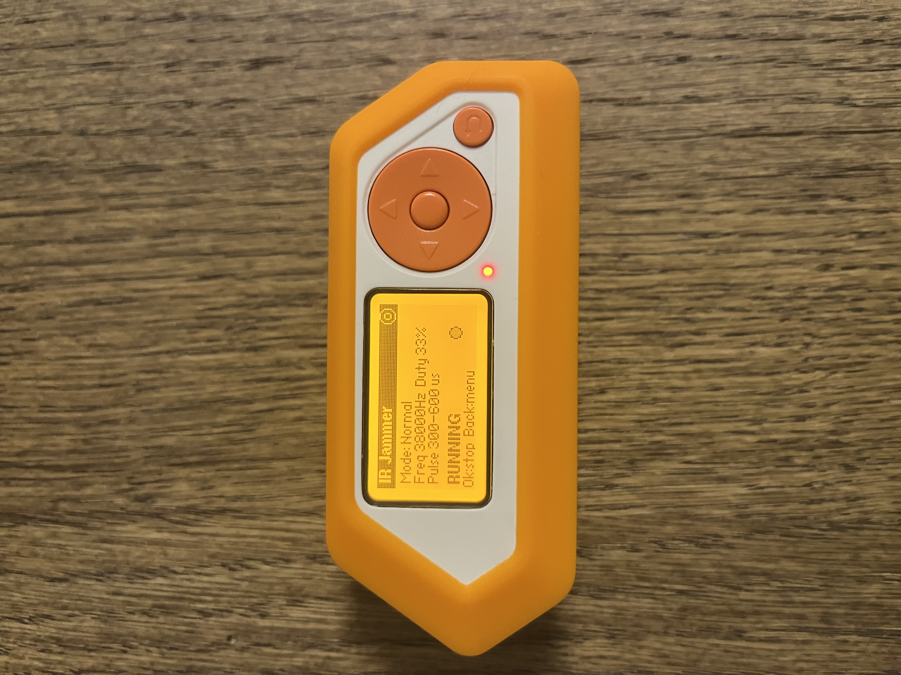

# IR-Jammer-Flipperzero

This flipper zero IR app uses the flipper zero's inferred transmitter to jam/block other IR signals from reaching a receiver.  

## -Menu
- Start-Allows you to start and stop the IR Jamming
- Settings-Allows you to configure many settings giving you full customisability over the jam.
- Info-Gives tips + tells you what each setting does.

## -How it works
The flipper will send off a large variety of powerful IR signals that have the goal of drowning out other weaker IR signals that get transmitted. This will block the signal causing it to be unable to reach any IR receivers. Note- when jamming, for best results aim the flippers IR transmitter at either the remote you want to jam, or directly at the receiver, this allows you to have full control over what IR signals make it through.

# -Thank you 
